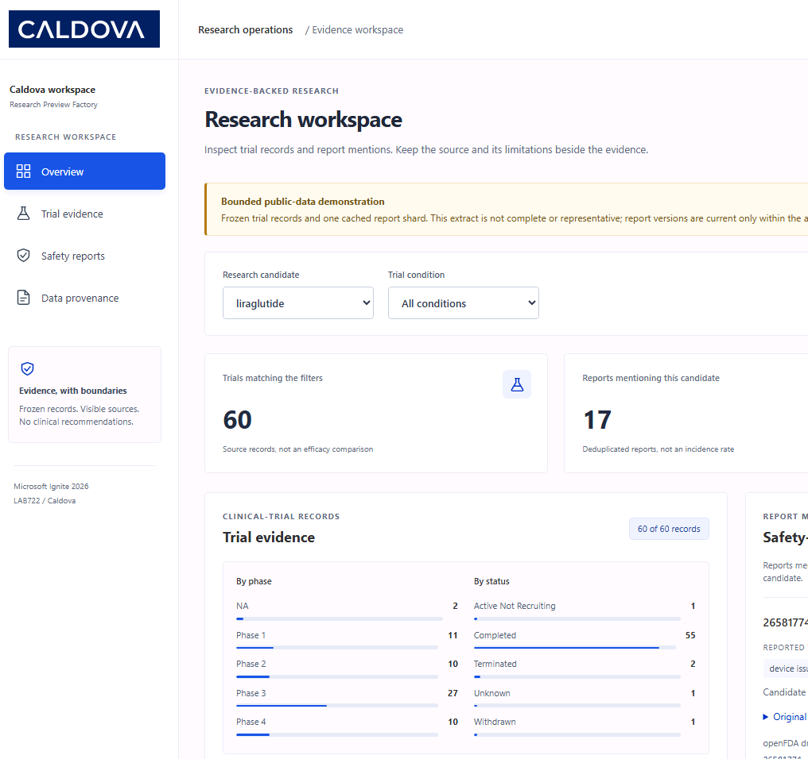
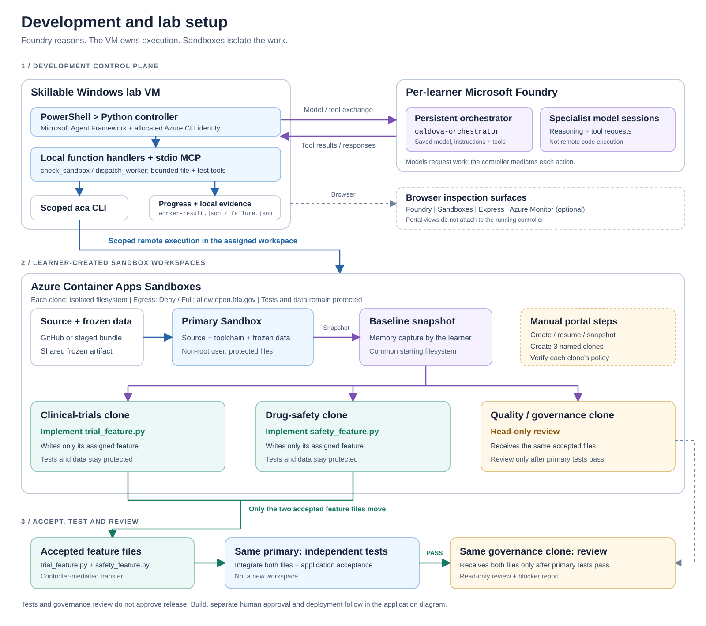

## Before you're done

This repo has been created for your Microsoft Ignite 2026 session. Here's how to get it ready.

**Easiest path — use the agent (recommended):**

- Open GitHub Copilot Chat and say `help me initialize repo`. The agent will walk you through getting the README populated.
- When you're ready to publish, say `help me finalize repo`. The agent will clean up unused folders, validate everything, and remove this "Before you're done" section and other extra stuff that attendees don't need to see.
- Curious how it works? Read the [agent workflow](.github/AGENT-WORKFLOW.md).

**Doing it manually?**

Fill in the sections below yourself, then:

- Delete any placeholder folders you don't need (`data/`, `infra/`, etc.)
- Delete this "Before you're done" section
- Delete `.github/agents/`, `.github/tests/`, `.github/copilot-instructions.md`, and `.github/AGENT-WORKFLOW.md` — these are template tooling, not part of your published repo

**Folder conventions:**

- Attendee step-by-step guidance goes in `instructions/`. If you use MkDocs or a docs site instead, put it in `docs/` and link to it from this README.
- Reference material and background reading go in `docs/`.
- You can add a `.devcontainer/` folder if needed.

---

<a name="start-building"></a>

<p align="center">

</p>

# [Microsoft Ignite 2026](https://ignite.microsoft.com)

## 🔥LAB722: Operate secure, multi-tenant agentic apps on Azure Container Apps
**`lab-reactor` redesign:** for a fresh deployment from your workstation, start with the [local azd walkthrough](docs/runtime-rejig/lab-rejig-local-walkthrough.md), then the [reactor learner guide](docs/runtime-rejig/lab-rejig-learner-instructions.md). The latest [allocation rehearsal and friction report](lab-pamela-friction.md) records a working additional-project recovery and completed technical exercises after two helper repairs; the original project remains unrepaired. The [earlier validation report](docs/runtime-rejig/reactor-walkthrough-report.md) describes the first allocation. Human pacing and Skillable delivery remain unverified. The older delivery instructions below and the root `azure.yaml` are historical for this branch; use the separate `local-reactor` azd profile, not the shared-key runtime.

### Session description

Build a governed research workflow for Caldova, a fictional pharmaceutical company. Configure a Microsoft Foundry orchestrator, run specialist agents in isolated Azure Container Apps Sandboxes, prove outbound network controls, and publish a validated research application to Azure Container Apps Express. The materials support guided and self-paced study; narrated segment videos are still planned.

### The lab at a glance

Start with an incomplete research application, use an agent team to implement its two missing query functions, then verify, package and deploy the result with separate human approval.

```text
Explore -> Plan -> Prepare isolated workspaces -> Implement and verify
        -> Build -> Approve and deploy -> Inspect the application and evidence
```

| Stage | What you do | What you learn |
|---|---|---|
| Explore and plan | Deploy the starter and inspect the clinical-trials, drug-safety and governance assignments | Define the work and distinguish model instructions from enforced software boundaries |
| Prepare and prove | Build the primary with `aca.exe`, snapshot it, create three clones and test isolation and egress | Give workers the same starting point without a shared mutable filesystem; verify actual controls |
| Implement and verify | Run the two implementors, test their combined changes independently in the primary, then run governance review | An agent's success message is not independent proof that the application works |
| Build and release | Build in ACR, review the exact image digest and target, authorize deployment and check the running app | Passing tests and a successful build are not deployment approval |
| Inspect and explain | Try the completed features, inspect citations and limitations, and compare the recorded example | Connect the visible result to its source, checks and release decisions |

**This is agent-assisted development, not an agent-powered application at runtime.** Foundry hosts reasoning and tool requests; the VM controller mediates execution; Sandboxes isolate development; Express runs the completed application. Participants operate and inspect the supplied controller and tools rather than build them from scratch.

The application uses a frozen AACT/ClinicalTrials.gov-derived and openFDA sample, not live research coverage. Citations and limitations remain visible alongside the results.



*Example of the completed application. An empty or populated result reflects the selected frozen sample, not clinical advice or comparative safety.*

### 🚀 Getting started

#### Run the lab in Skillable

**Skillable is the intended delivery environment** for the approximately 75-minute guided or self-paced lab.

1. Launch your assigned Skillable lab and open its Windows VM. Use the VM and Azure credentials from the lab's **Resources** tab, not a personal Azure account.
2. Follow the instruction panel, also maintained as the [participant guide](instructions/README.md) and [generated Skillable manual](instructions/skillable.md). Use one PowerShell 7 session throughout.
3. Verify the prepared checkout, tools, frozen dataset and allocated Azure resources. Infrastructure deployment is platform preparation, not a learner exercise.
4. Create the starter Express app, prepare the primary and clones, run the agents, and build and deploy your accepted changes. The learner explicitly reviews and authorizes release.

The prepared VM checkout is `C:\Users\LabUser\code\ignite26-LAB722`. The lab uses a per-learner Foundry project/model endpoint, Sandbox group, registry and Express infrastructure. Remote operations can take longer than the target timings. Instructors can use the [presentation and speaker notes](presentations/README.md) to orient learners between segments.

#### Run the completed application locally

To explore the application without provisioning Azure resources, use **Docker with Linux containers** and a checkout of this repository. From the repository root in PowerShell:

```powershell
$images = Get-Content '.\data\lab-images.json' -Raw | ConvertFrom-Json
$referenceImage = '{0}/{1}@{2}' -f $images.registry, $images.repository, $images.images.reference.digest
docker run --name lab722-caldova-local --publish 127.0.0.1:8080:8080 $referenceImage
```

While the container is running, open [http://localhost:8080](http://localhost:8080). This uses the catalog's public, digest-pinned **completed reference image** with the frozen v2 dataset; no Azure sign-in or registry credentials are required. Stop with `Ctrl+C`; reuse the retained container with `docker start --attach lab722-caldova-local`.

This is an application preview, **not** an agent run, Sandbox exercise or evidence that your own changes passed. To build the application from the checked-in source instead, see the [research portal source](src/README.md#research-portal) and its [Containerfile](src/research-portal/Containerfile); the default source build uses synthetic development data rather than the frozen lab sample.

#### Run the full workflow from your own machine

The end-to-end lab still needs Azure: Foundry model access and quota, a Sandbox group with capacity for the primary and three workers, ACR, Express infrastructure and the required permissions. Local Docker does not emulate those services.

Prepare your own environment using the [facilitator handoff](instructions/facilitator.md), [infrastructure setup](infra/README.md) and [startup/runtime guidance](scripts/README.md#platform-neutral-startup), then follow the same [participant sequence](instructions/README.md). Keep the application and controller Python environments separate. Replace Skillable-specific checkout/runtime paths with your own prepared paths, and use only your authorized subscription and resource group.

Without those cloud resources, the bundled [recorded example](instructions/assets/development-evidence.html) provides a read-only source-to-deployment walkthrough alongside the local application preview. Its receipts describe a recorded run, not a new local execution.

### 🎯 Learning outcomes

By the end of this session, you will be able to:

- Configure a Microsoft Foundry orchestrator that assigns bounded work to specialist agents and requires approval for sensitive actions.
- Prepare, snapshot, and clone Azure Container Apps Sandboxes while enforcing approved and denied outbound network destinations.
- Validate agent-produced application changes with deterministic evidence and publish the approved image to Azure Container Apps Express.

### 💻 Technologies used

- Azure Container Apps Sandboxes
- Azure Container Apps Express
- Microsoft Foundry Agent Service
- Microsoft Agent Framework for Python
- Azure Container Registry
- Azure Monitor Application Insights
- Azure Developer CLI (`azd`)
- Bicep and Azure Resource Manager templates
- React and TypeScript
- GitHub source and the controller-owned stdio Model Context Protocol bridge

### Architecture

The lab separates agent-assisted development from application serving. Models reason in Microsoft Foundry; the controller on the lab VM mediates execution in remote Sandboxes. The deployed application serves packaged research data, not a live agent workflow.

#### Learner and development control plane



[Open the development architecture SVG](docs/diagrams/development-lab-architecture.svg) to inspect the full diagram.

| Component | Responsibility |
|---|---|
| Microsoft Foundry | Persistent orchestrator and specialist model sessions: reasoning and tool requests |
| Lab VM controller | Local function handlers, scoped `aca.exe` execution, the stdio MCP bridge and saved run evidence |
| Container Apps Sandboxes | Non-root development workspaces with protected files, isolated clone filesystems and explicit egress policies |
| Container Apps Express | The learner-facing application, serving its packaged read-only research data |

Foundry requests `check_sandbox` or `dispatch_worker`; their function handlers run on the VM. Workers use controller-mediated MCP tools for bounded remote file edits and tests. Opening a Foundry playground does **not** start or attach to the running PowerShell controller. See [Meet the agent team](instructions/02-configure-orchestrator.md).

The learner creates three isolated clones from the prepared snapshot. Each implementor can change only its assigned feature module; data and tests stay protected. Only the two accepted feature files move into both the primary and governance workspaces. Passing tests and governance review do not grant release approval. Follow [Run the agent team](instructions/04-run-agent-team.md).

The VM displays role, MCP tool, phase and elapsed-time progress. Its main debugging/review surface is the saved `.validation-workspaces\agent-runs\<run-id>\worker-result.json` (including returned source hashes) or `failure.json`. The Foundry portal is not a complete VM/MCP trace viewer unless additional tracing is configured.

#### Build, release and application serving

```text
VM: SHA-256-pinned accepted worker result + hash-checked returned source
    + unchanged frozen data
      |
      `--> Staged build context on VM
             |
             `--> ACR Tasks: candidate image build + container acceptance
                    |
                    `--> Candidate image digest (not approved for deployment)
                           |
                           `--> Separate human approval
                                (run + dataset + exact digest + target app)
                                  |
                                  `--> Deploy that exact digest to ACA Express

Attendee browser --> ACA Express-hosted Caldova application
                       React UI --> FastAPI API
                                      |
                                      `--> Packaged read-only DuckDB + source records
```

Application queries do **not** call Foundry, workers or MCP. The Azure Monitor workbook is an optional observation surface for available app/platform signals, not comprehensive controller tracing; no workbook is supplied by this repository. Use the local evidence to follow the development run, then compare the built and deployed digests in [Build and deploy](instructions/05-build-and-publish.md) and [Compare with a recorded example](instructions/06-trace-the-evidence.md).

### 📚 Continue your learning

Pick your next step based on your learning style:

| Resource | What you'll get |
|----------|-----------------|
| **[Ignite 2026 Next Steps](https://aka.ms/ignite26-next-steps)** | Additional session repos and materials from Microsoft Ignite 2026 |
| **[Microsoft AI Skills Navigator](https://aka.ms/ignite26-asn)** | Discover AI skills, learning paths, and resources for your next step |
| **[Microsoft Learn](https://aka.ms/ignite26-learn)** | Official documentation and guided learning paths on these topics |
| **[Microsoft Foundry Community](https://aka.ms/MicrosoftFoundryDiscord-Ignite26)** | Connect with other learners and experts in our Discord community |

### 🌟 Microsoft Learn MCP Server

<!-- Remove this section if the Microsoft Learn MCP Server is not relevant to the session. -->

The Microsoft Learn MCP Server gives your AI agent direct access to Microsoft's official documentation — grounded, up-to-date answers about the topics in this session.

**GitHub Copilot CLI** — Install with:

```shell
copilot plugin install microsoftdocs/mcp
```

**VS Code** — One-click install:

[](https://vscode.dev/redirect/mcp/install?name=microsoft-learn&config=%7B%22type%22%3A%22http%22%2C%22url%22%3A%22https%3A%2F%2Flearn.microsoft.com%2Fapi%2Fmcp%22%7D)

For more information, visit the [Learn MCP Server repo](https://aka.ms/learnmcp).

### 👥 Content owners

<table>
<tr>
    <td align="center"><a href="https://github.com/simonjj">
        <br />
        <sub><b>simonjj</b></sub></a><br />
            <a href="https://github.com/simonjj" title="GitHub profile">📢</a>
    </td>
</tr></table>

### ⚖️ Trademarks

This project may contain trademarks or logos for projects, products, or services. Authorized use of Microsoft trademarks or logos is subject to and must follow [Microsoft's Trademark & Brand Guidelines](https://www.microsoft.com/legal/intellectualproperty/trademarks/usage/general). Use of Microsoft trademarks or logos in modified versions of this project must not cause confusion or imply Microsoft sponsorship.

Any use of third-party trademarks or logos are subject to those third-party's policies.
