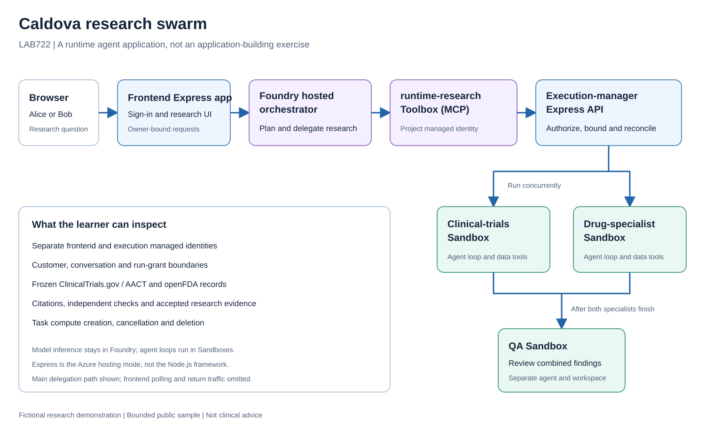

# Runtime architecture and trust boundaries

## Request path

1. The browser signs into the [frontend](../src/reactor/frontend.py), a Python web application hosted on Azure Container Apps Express. Here, **Express is the Azure hosting mode**, not the Node.js Express framework.
2. The frontend creates owner-bound work through the [execution API](../src/reactor/execution.py) and invokes the [Foundry-hosted orchestrator](../src/reactor/hosted.py). The frontend also polls execution state; the diagram's main chain is the agent-delegation path, not every HTTP request.
3. The orchestrator uses the **runtime-research** managed Toolbox over MCP. The [Toolbox setup](../scripts/setup-reactor-foundry.py) binds the [OpenAPI operations](../src/reactor/openapi.json) to the execution API through a project-managed-identity connection.
4. The execution manager launches [clinical-trials and drug-specialist agents](../src/reactor/agent_runtime.py) in separate, request-owned Sandboxes. Their agent loops and bounded data tools run there; model inference remains in Foundry.
5. After both specialists finish, a separate QA Sandbox checks their combined work. [Deterministic evaluation](../src/reactor/evaluation.py) checks the reported results against the frozen public records.
6. Results and independent evidence return to the owning session. [Sandbox lifecycle management](../src/reactor/sandboxes.py) reconciles and deletes task compute, including cancellation paths. Teaching seeds and snapshots are intentionally retained.

## Identity and customer boundaries

The frontend and execution API have separate managed identities. [Service authentication](../src/reactor/service_auth.py) verifies the token audience and permitted caller object IDs; a reachable HTTP endpoint does not authorize arbitrary callers.

[Ownership state](../src/reactor/ownership.py) binds a run to its customer, principal and conversation. An additional [run grant](../src/reactor/binding.py) travels through Toolbox to the specialist operations. Alice and Bob are application demo accounts, not Azure accounts. Cross-customer access is denied even when a caller knows another run ID.

## Execution and quality boundaries

The orchestrator requests bounded work; the execution API controls actual Sandbox creation, budgets and lifecycle. Specialists run concurrently, then QA runs after both complete. A model's final answer, a configured endpoint and `HostedConnected=true` are not proof that a research result was accepted.

Inspect the run's returned evidence, the independent checks and actual task inventory. Retries reuse their owned work where supported; after an uncertain create or hosted-version failure, inspect the retained operation rather than blindly submitting another.

## Data boundary

The [frozen dataset](../data/README.md) contains a bounded AACT/ClinicalTrials.gov-derived and openFDA sample. The [image catalog](../data/reactor-research-images.json) pins the services, hosted orchestrator and preloaded specialist images by digest. Source records, citations and coverage limitations remain part of the research result.

This is a fictional research demonstration, not live clinical coverage, comparative safety analysis or medical advice.
