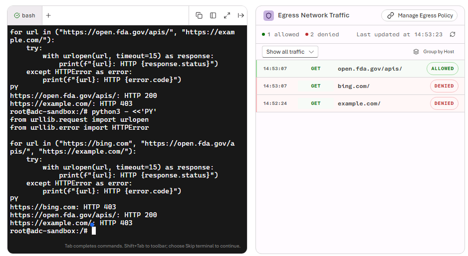
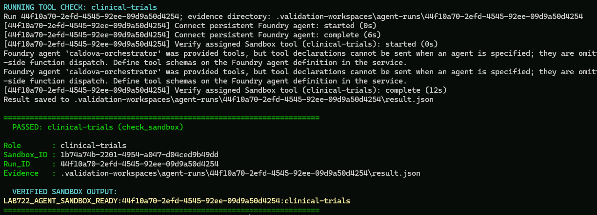

# 8. Create the Sandbox workspaces for our specialists

Each specialist needs an isolated workspace with the same starting code, tools, and data. You will create the **primary Sandbox** with explicit `aca.exe` commands, then capture its snapshot and create three worker clones in the **Sandbox portal**.

The primary workspace will later be used to combine the workers’ changes and run independent integration and application-acceptance tests.

## 8.1 Prepare only the primary

**Goal:** understand the chain **local source + frozen data → developer disk → running primary → verified baseline**. A disk is an image used to create a Sandbox, not a running workspace. This creates a **new disk and new primary**; it does not update an existing primary in place.

Use the same **VM PowerShell** window throughout. Run one command box at a time and inspect its output before continuing. Cloud creation is not hidden in a preparation script: you will issue `disk create`, `sandbox create` and `lifecycle set` yourself. Two repository tools remain for different purposes: packaging local build inputs and independently checking the finished primary.

**Already built a disk?** Keep your existing session, source directory and `$primaryDiskName`. Resume at **8.1.4** instead of restarting setup or running `disk create` again. If you already submitted a primary, use the discovery/selection commands in **8.1.5**, not its create command.

### 8.1.1 Inspect your scope and available capacity

First check the prerequisites and display the exact subscription, resource group, region and Sandbox group. `@acaPrimaryScope` simply expands those four CLI arguments; it is not a provisioning helper.

```powershell
$ErrorActionPreference = 'Stop'
$baselineDescriptorPath = $bindingsPath = $baselineDescriptorSha256 = $validationSandboxId = $preparedManifestPath = $null
$primarySource = $verifiedPrimary = $primaryDescriptor = $primaryDescriptorPath = $primaryDescriptorSha256 = $null
$diskId = $primaryId = $primaryDisk = $null
if (-not $plan -or -not $plan.plan -or -not $plan.plan.run_id) {
    throw 'Complete Review the Agent Team''s plan successfully before preparing the primary Sandbox.'
}
if ([string]::IsNullOrWhiteSpace($env:LAB_DATA_MANIFEST) -or
    -not (Test-Path -LiteralPath $env:LAB_DATA_MANIFEST -PathType Leaf) -or
    $env:LAB_DATA_MANIFEST_SHA256 -cnotmatch '^[a-f0-9]{64}$' -or
    $env:LAB_STARTUP_PURPOSE -cne 'public-lab-development' -or
    [string]::IsNullOrWhiteSpace($env:LAB_PYTHON_EXECUTABLE)) {
    throw 'The verified local dataset session is missing. Rerun the starter application helper and planning step in this PowerShell window.'
}
$primaryScope = @{
    SubscriptionId = [guid] $labOutputs.AZURE_SUBSCRIPTION_ID
    ResourceGroup = $resourceGroupName
    Region = $labOutputs.SANDBOX_REGION
    GroupName = $labOutputs.SANDBOX_GROUP_NAME
}
$acaPrimaryScope = @(
    '--subscription', $primaryScope.SubscriptionId.ToString(),
    '--resource-group', $primaryScope.ResourceGroup,
    '--region', $primaryScope.Region, '--group', $primaryScope.GroupName
)
$primaryScope | Format-List
```

Group capacity is **ARM metadata**. Read it with Azure CLI; this does not change the group or grant permissions.

```powershell
$primaryGroupId = "/subscriptions/$($primaryScope.SubscriptionId)/resourceGroups/$($primaryScope.ResourceGroup)/providers/Microsoft.App/sandboxGroups/$($primaryScope.GroupName)"
$primaryGroupUrl = "https://management.azure.com${primaryGroupId}?api-version=2026-02-01-preview"
$groupText = az rest --method get --url $primaryGroupUrl `
    --subscription $primaryScope.SubscriptionId --output json --only-show-errors
if ($LASTEXITCODE -ne 0) { throw 'Unable to read group capacity. No disk has been submitted.' }
$groupDetails = ($groupText -join "`n") | ConvertFrom-Json
if ($groupDetails.id -ine $primaryGroupId -or $groupDetails.location -ine $primaryScope.Region -or
    $groupDetails.properties.provisioningState -cne 'Succeeded') {
    throw 'Group identity, region or provisioning state does not match the expected scope.'
}
$capacity = $groupDetails.properties.maxSandboxCount
if (($capacity -isnot [int] -and $capacity -isnot [long]) -or $capacity -lt 1) {
    throw 'The group did not return a positive integer maxSandboxCount.'
}
$groupDetails.properties | Select-Object maxSandboxCount, provisioningState
```

Now inspect the **existing Sandboxes** through `aca.exe`. You need four free slots: one primary and three later workers. This check is not a reservation. Do not delete existing workspaces to make room.

```powershell
$inventoryText = aca.exe sandbox list @acaPrimaryScope -o json
if ($LASTEXITCODE -ne 0) { throw 'Unable to list existing Sandboxes.' }
$inventory = ($inventoryText -join "`n") | ConvertFrom-Json -AsHashtable -NoEnumerate
if ($inventory -is [Collections.IDictionary]) {
    if ($inventory.nextLink -or
        @($inventory.Keys | Where-Object { $_ -notin @('value', 'nextLink') }).Count) {
        throw 'Sandbox inventory is incomplete or paged. Stop before creating resources.'
    }
    $inventory = $inventory.value
}
if ($inventory -isnot [array]) { throw 'Expected a complete JSON array, not a partial or paged inventory.' }
$inventoryIds = @($inventory | ForEach-Object {
    $inventoryId = [guid]::Empty
    if (-not [guid]::TryParse($_.id, [ref] $inventoryId) -or $inventoryId -eq [guid]::Empty) {
        throw 'Sandbox inventory contains an invalid resource ID.'
    }
    $inventoryId.ToString()
})
if (@($inventoryIds | Select-Object -Unique).Count -ne $inventory.Count) {
    throw 'Sandbox inventory contains duplicate resource IDs.'
}
$inventoryText
"Allocated: $($inventory.Count); capacity: $capacity; free: $($capacity - $inventory.Count)"
if ($capacity - $inventory.Count -lt 4) {
    throw 'Fewer than four Sandbox slots are free. Keep existing resources and ask for help.'
}
```

### 8.1.2 Inspect the local image inputs

The local exporter copies an allowlist of source files and the **already verified frozen dataset** into a new build directory. It does not create an Azure resource or put Azure credentials in the image. Keep the returned source revision and manifest hash: the final check uses them to detect changed inputs.

```powershell
$primarySource = $diskId = $primaryId = $primaryDisk = $null
$primaryAttemptId = [guid]::NewGuid().ToString('N')
$primaryAttemptDirectory = Join-Path '.build-contexts' "manual-primary-$primaryAttemptId"
$primarySourceDirectory = Join-Path $primaryAttemptDirectory 'source'
$primaryOutputDirectory = Join-Path $primaryAttemptDirectory 'verified'
$primaryDiskName = "lab722-developer-$primaryAttemptId"
$primaryName = "caldova-primary-$primaryAttemptId"
$primaryDiskCreateAttempted = $primaryCreateAttempted = $false
$sourceText = & $env:LAB_PYTHON_EXECUTABLE .\src\developer-image\export_source.py `
    --destination $primarySourceDirectory `
    --manifest $env:LAB_DATA_MANIFEST `
    --manifest-sha256 $env:LAB_DATA_MANIFEST_SHA256 `
    --purpose public-lab-development
if ($LASTEXITCODE -ne 0) { throw 'Source export failed. No disk has been submitted.' }
$primarySource = ($sourceText -join "`n") | ConvertFrom-Json
$primarySource | Select-Object directory, source_revision, source_context_manifest_sha256 | Format-List
```

Read the staged Dockerfile. Find the base images, application workspace, frozen-data copy/staging and non-root user. This is what the next command builds; it is not a worker source bundle. Do not edit the staged files.

```powershell
Get-Content (Join-Path $primarySource.directory 'Dockerfile')
```

### 8.1.3 Build the developer disk with aca.exe

`--source` submits that local Dockerfile directory to the Sandbox image builder. `--name` identifies this attempt; `--wait-timeout 900` lets the CLI wait for up to 15 minutes. A developer disk is created, **not yet a Sandbox**.

Run this create command **once**. The attempt flag prevents an accidental repeat in this session; it does not manage cloud resources.

```powershell
if (-not $primarySource -or -not $primarySource.directory) { throw 'Export the verified source first.' }
if ($primaryDiskCreateAttempted) { throw 'Disk creation was already attempted. Continue at 8.1.4; do not resubmit it.' }
$primaryDiskCreateAttempted = $true
aca.exe sandboxgroup disk create @acaPrimaryScope `
    --source $primarySource.directory --name $primaryDiskName --wait-timeout 900
if ($LASTEXITCODE -ne 0) { throw 'Disk creation stopped. Inspect the existing operation with 8.1.4 before any retry.' }
```

### 8.1.4 Select the disk by its GUID ID

Discover the disk from this attempt. This command is safe to repeat while inspecting a submitted build.

```powershell
aca.exe sandboxgroup disk list @acaPrimaryScope --selector "name=$primaryDiskName" -o json
if ($LASTEXITCODE -ne 0) { throw 'Disk discovery failed. Do not submit another disk.' }
```

Copy the JSON **`id`** value, a hyphenated GUID. **Do not copy `name`** (`lab722-developer-...`) or derive an ID from its suffix. Then fetch that exact disk and check its name and `Ready` state.

```powershell
$diskId = $primaryDisk = $null
$selectedDiskId = [guid]::Empty
if (-not [guid]::TryParse((Read-Host 'Paste only the id GUID of your developer disk'), [ref] $selectedDiskId) -or
    $selectedDiskId -eq [guid]::Empty) {
    throw 'Use the JSON id GUID, not the disk name. Rerun only this selection box, not disk create.'
}
$diskText = aca.exe sandboxgroup disk get @acaPrimaryScope --id $selectedDiskId -o json
if ($LASTEXITCODE -ne 0) { throw 'Unable to inspect the selected disk.' }
$primaryDisk = ($diskText -join "`n") | ConvertFrom-Json
if ($primaryDisk.id -ine $selectedDiskId.ToString() -or $primaryDisk.name -cne $primaryDiskName -or
    $primaryDisk.status.state -cne 'Ready') {
    throw 'The selected disk is not the Ready disk from this source-export attempt.'
}
$diskId = $selectedDiskId
$primaryDisk | Select-Object id, name, status | Format-List
```

**Checkpoint:** you can explain which local files became this disk, and you have its exact GUID. No primary has been created by these steps.

### 8.1.5 Create and identify the primary

Before creating it, repeat the **two read-only capacity/inventory command boxes in 8.1.1**. A disk build can take time; confirm that four slots are still free.

Predict what **Deny**, **Full** inspection and the single `open.fda.gov` allow rule will permit. The flags below request **2 vCPUs / 4 GiB** and boot the new primary from **your disk ID**. The `lab`, `role` and unique `name` labels identify the result; they are not its GUID.

```powershell
if (-not $diskId -or -not $primaryDisk -or $primaryDisk.id -ine $diskId.ToString() -or
    $primaryDisk.name -cne $primaryDiskName -or $primaryDisk.status.state -cne 'Ready') {
    throw 'Select and verify your developer disk first.'
}
if ($primaryId -or $primaryCreateAttempted) { throw 'A primary was already selected or submitted. Use the discovery commands below.' }
$primaryCreateAttempted = $true
aca.exe sandbox create @acaPrimaryScope --disk-id $diskId `
    --cpu 2000m --memory 4096Mi `
    --label lab=LAB722 --label role=primary --label "name=$primaryName" `
    --egress-default Deny --egress-rule open.fda.gov:Allow `
    --traffic-inspection Full --wait-timeout 900
if ($LASTEXITCODE -ne 0) { throw 'Primary creation stopped. Inspect the submitted operation below; do not blindly repeat create.' }
```

Discover the primary by its labels. Use this same read-only command after a timeout; a submitted create may still have succeeded.

```powershell
aca.exe sandbox list @acaPrimaryScope --selector "lab=LAB722,role=primary,name=$primaryName" -o json
if ($LASTEXITCODE -ne 0) { throw 'Primary discovery failed. Keep the existing operation.' }
```

Copy its JSON **`id` GUID**, then check the exact primary before changing its lifecycle. A wrong name or ID requires only repeating selection, not creation.

```powershell
$primaryId = $null
$selectedPrimaryId = [guid]::Empty
if (-not [guid]::TryParse((Read-Host 'Paste only the id GUID of your primary Sandbox'), [ref] $selectedPrimaryId) -or
    $selectedPrimaryId -eq [guid]::Empty) {
    throw 'Use the JSON id GUID, not the primary name. Rerun only this selection box, not sandbox create.'
}
$primaryText = aca.exe sandbox get @acaPrimaryScope --id $selectedPrimaryId -o json
if ($LASTEXITCODE -ne 0) { throw 'Unable to inspect the selected primary.' }
$selectedPrimary = ($primaryText -join "`n") | ConvertFrom-Json
if ($selectedPrimary.id -ine $selectedPrimaryId.ToString() -or
    $selectedPrimary.labels.name -cne $primaryName -or
    $selectedPrimary.labels.role -cne 'primary' -or $selectedPrimary.labels.lab -cne 'LAB722') {
    throw 'That ID does not identify the primary created in this attempt.'
}
$primaryId = $selectedPrimaryId
$selectedPrimary | Select-Object id, labels | Format-List
```

### 8.1.6 Set the lifecycle explicitly

Configure **Memory** auto-suspend after **900 idle seconds** and leave **auto-delete disabled**. This changes the selected primary's policy, not its disk contents.

```powershell
if (-not $primaryId) { throw 'Select and verify your primary ID first.' }
aca.exe sandbox lifecycle set @acaPrimaryScope --id $primaryId `
    --auto-suspend enable --idle-timeout-seconds 900 `
    --mode Memory --auto-delete disable
if ($LASTEXITCODE -ne 0) { throw 'Lifecycle configuration failed. Inspect this existing primary.' }
```

### 8.1.7 Inspect the result, not just command success

Read back the egress policy. Expect **Deny**, **Full**, and only `open.fda.gov:Allow`.

```powershell
aca.exe sandbox egress show @acaPrimaryScope --id $primaryId
if ($LASTEXITCODE -ne 0) { throw 'Unable to inspect primary egress.' }
```

Read back the lifecycle. Expect auto-suspend enabled, **900 seconds**, **Memory**, and auto-delete disabled.

```powershell
aca.exe sandbox lifecycle show @acaPrimaryScope --id $primaryId
if ($LASTEXITCODE -ne 0) { throw 'Unable to inspect primary lifecycle.' }
```

Execute a small command **inside the remote Sandbox**, not on the VM. Expect **UID 10001** and `/opt/caldova-lab`.

```powershell
aca.exe sandbox exec @acaPrimaryScope --id $primaryId `
    --working-directory /opt/caldova-lab --command 'id -u; pwd'
if ($LASTEXITCODE -ne 0) { throw 'The primary command failed.' }
```

**Checkpoint:** identify which command built the disk, which booted the workspace, which set its lifecycle and which proved a command ran remotely. Neither a successful build nor selecting a disk ID updates an existing primary.

### 8.1.8 Independently verify and record the primary

The final repository helper is an **acceptance check**, not a provisioning shortcut. `VerifyPrimary` checks the original source-context hashes, frozen data, protected files, genuinely missing feature functions, UID, network policy and lifecycle. It creates **no cloud resources**, changes no policy and captures no snapshot. Only after these checks pass does it write the pinned local descriptor needed to register your later clones.

```powershell
$verifiedPrimary = $primaryDescriptor = $primaryDescriptorPath = $primaryDescriptorSha256 = $null
$verifiedPrimary = .\scripts\prepare-worker-baseline.ps1 @primaryScope `
    -Mode VerifyPrimary -DiskId $diskId -PrimaryId $primaryId `
    -SourceContextDirectory $primarySource.directory `
    -SourceContextManifestSha256 $primarySource.source_context_manifest_sha256 `
    -FrozenManifest $env:LAB_DATA_MANIFEST -FrozenManifestSha256 $env:LAB_DATA_MANIFEST_SHA256 `
    -Purpose public-lab-development -OutputDirectory $primaryOutputDirectory -AsJson |
    ConvertFrom-Json
if (-not $verifiedPrimary -or $verifiedPrimary.phase -cne 'primary-prepared') {
    throw 'The primary did not pass verification. Keep the diagnostics.'
}
$primaryDescriptorPath = $verifiedPrimary.descriptor
$primaryDescriptorSha256 = $verifiedPrimary.descriptor_sha256
$primaryDescriptor = Get-Content $primaryDescriptorPath -Raw | ConvertFrom-Json
$verifiedPrimary | Select-Object phase, primary_id, disk_id | Format-List
$primaryDescriptor.scope | Format-List
$primaryDescriptor | Select-Object dataset_version, uid, workspace | Format-List
Start-Process 'https://sandboxes.azure.com/'
```

**Expected:** phase `primary-prepared`, your exact primary/disk IDs, UID **10001** and the supplied dataset version. You have prepared only the primary, not a worker baseline. Keep this PowerShell window open and leave the source context unchanged.

If a create fails or times out, stop and retain the operation and its error. Use the separate **list/get** commands to inspect it; do not rerun creation or delete existing resources. Ask your instructor for help if its state is unclear.

<!-- pagebreak -->

# 9. Capture your baseline snapshot

In [https://sandboxes.azure.com/](https://sandboxes.azure.com/), select the displayed subscription and Sandbox group. Open the **primary ID** shown in PowerShell, not a worker from another exercise. If it is stopped, resume it before using its terminal or taking a snapshot.

**Note:** The web-based Sandbox browser terminal does not work well with Ctrl+C/V and the lab's type signals. Use your mouse's right-click to copy and paste.

The image and controller use **caldova**, UID **10001**, but the portal's interactive terminal can still open as root; the image's `USER` setting does not reliably select this separate terminal's user. Run this single line in each newly opened browser terminal. It replaces a root shell with a caldova shell and prints the resulting UID; an already-caldova shell stays unchanged:

```bash
if [ "$(id -u)" -eq 0 ]; then exec su -s /bin/sh caldova -c 'id -u; exec /bin/sh'; fi; id -u
```

The message `/bin/sh: 0: can't access tty; job control turned off` is expected in this browser terminal and can be ignored.

Expect **10001** before running the exercise commands. If another UID appears or switching fails, stop and ask your instructor; do not change image permissions. Repeat after reconnecting because a new portal terminal is a new session.

As UID `10001`, create a small note outside the protected application. These are Linux commands, not VM PowerShell commands:

```bash
id -u && printf '%s\n' 'prepared-primary' > /tmp/lab722-clone-note.txt && cat /tmp/lab722-clone-note.txt
```

Expect UID `10001` and `prepared-primary`. Leave the application source, tests and data unchanged.

Open **More actions > Memory Snapshot**. If prompted for a name, use `caldova-baseline`. Wait for capture to finish, then find the new item under the group's **Snapshots** tab. Record its ID and confirm that it belongs to your primary.

## 9.1 Create three clones yourself

From the group, choose **Create sandbox > Standard**, select **Advanced**, and choose **Snapshot** as the source. Select **your new snapshot ID**, not a public image or an older snapshot.

Create one clone for each exact **Name label**:

| Name label | Assignment |
|---|---|
| `clinical-trials` | Trial feature |
| `drug-safety` | Safety feature |
| `quality-governance` | Independent review |

For **every** clone, set these values **before creating it**:

| Setting | Expected value |
|---|---|
| Default Action | Deny |
| Traffic inspection | Full |
| Egress rule | Allow the exact host `open.fda.gov`; no other allow rules |
| Auto-suspend | Enabled; idle timeout **900 seconds**; mode **Memory** |
| Auto-delete | Off |
| Configure MCP connectors | Off |
| Configure API connectors | Off |

Do not add a scheme, wildcard or path to the host. CPU, memory and disk sizes are inherited from the snapshot; leave them unchanged.

Submit each create form and wait until the clone is ready. You will trial one clone's network policy next.

<!-- pagebreak -->

# 10. Prove inheritance and isolation

Open the **clinical-trials clone's browser terminal**, resuming it first if necessary. Use the same user-selection line above and verify UID **10001**, then run:

```bash
cat /tmp/lab722-clone-note.txt && printf '%s\n' 'clinical-only' > /tmp/lab722-clone-note.txt && cat /tmp/lab722-clone-note.txt
```

Expect `prepared-primary`, followed by `clinical-only`. Then open the **drug-safety clone's** browser terminal, select/verify UID **10001** the same way, and run:

```bash
cat /tmp/lab722-clone-note.txt
```

Expect `prepared-primary` there. **Learning:** The clones inherited one starting filesystem, but changing one clone did not change the other. The primary also remains separate for later integration tests.

## 10.1 Test & try the Egress policy

Stay in the **drug-safety clone**. Open **More actions > Egress Policy**, look at the default action and allowed host, then close the dialog without changing it.

**Predict first:** which request should work: `open.fda.gov` or `example.com`? Why?

Return to that clone's **browser terminal** and paste this block. It uses the installed Python runtime to send two read-only requests and print their HTTP status:

```bash
python3 - <<'PY'
from urllib.request import urlopen
from urllib.error import HTTPError

for url in ("https://open.fda.gov/apis/", "https://example.com/"):
    try:
        with urlopen(url, timeout=15) as response:
            print(f"{url}: HTTP {response.status}")
    except HTTPError as error:
        print(f"{url}: HTTP {error.code}")
PY
```

**Compare:** expect **HTTP 200** for `open.fda.gov` and **HTTP 403** for `example.com`. If the second request succeeds, inspect this clone's policy: it must be **Deny / Full**, with only `open.fda.gov` allowed. Do not add an exception for `example.com` or turn off inspection. A timeout, DNS error or TLS error is **not** proof of a policy denial; keep the diagnostic and ask your instructor if the expected responses cannot be obtained.



**Explain:** what enforced the restriction: the agent's prompt, or the Sandbox's network policy? How can the agent do useful work without unrestricted internet access?

## 10.2 Register the workspaces you created

Make sure the **primary and all three clones are running**; start or resume stopped ones in the portal. Return to **VM PowerShell**. This block discovers your primary's snapshot and the three exact Name labels, then verifies lineage, policy, UID, protected files, frozen data and missing functions. **It creates no cloud resources and does not fix a wrong policy for you.**

```powershell
. {
    $ErrorActionPreference = 'Stop'
    $baselineDescriptorPath = $bindingsPath = $baselineDescriptorSha256 = $validationSandboxId = $preparedManifestPath = $null
    $registered = .\scripts\connect-lab-workers.ps1 -PrimaryDescriptorPath $primaryDescriptorPath `
        -PrimaryDescriptorSha256 $primaryDescriptorSha256 -AsJson | ConvertFrom-Json
    if (-not $registered -or -not (Test-Path -LiteralPath $registered.descriptor -PathType Leaf)) {
        throw 'Registration did not produce a verified baseline. Keep the diagnostics.'
    }
    $baselineDescriptorPath = $registered.descriptor
    $baselineDescriptorSha256 = $registered.descriptor_sha256
    $bindingsPath = $registered.bindings
    $preparedManifestPath = $registered.manifest
    $validationSandboxId = $registered.primary_id
    $baselineDescriptor = Get-Content $baselineDescriptorPath -Raw | ConvertFrom-Json
    $bindings = Get-Content $bindingsPath -Raw | ConvertFrom-Json
    $baselineDescriptor | Select-Object primary_id, snapshot_id, dataset_version | Format-List | Out-Host
    $bindings | Format-Table role, sandbox_id, snapshot_id, workspace
}
```

Match the three distinct worker IDs and shared snapshot ID to the portal. The workspace is `/opt/caldova-lab`. Keep these PowerShell variables for the next exercises.

If registration rejects a policy or lifecycle setting, correct that **existing clone** in the portal and retry this registration block. It will not recreate your workspaces. If you captured more than one snapshot of the primary, pass `-SnapshotId '<your chosen snapshot ID>'` to the helper. For missing workspaces, quota errors or failed preparation, keep the diagnostics and contact your instructor; do not blindly repeat creation or delete resources.

**Checkpoint:** you captured the baseline, created the workers, demonstrated isolation, and registered only workspaces that passed verification.

**Catch-up, only if you could not complete this portal exercise:** check that four additional slots are available, then run the registration block above with **`-CatchUp`** added to `connect-lab-workers.ps1`. This explicitly creates a **replacement** verified primary, snapshot and three workers; it retains all attempted resources and requires **four additional free slots**. Use the replacement IDs it returns and skip the unfinished portal steps. It does not claim that you completed them. If capacity is unavailable, stop and contact your instructor; do not delete existing resources or rerun catch-up.

<!-- pagebreak -->

# 11. Run a tool in a selected Sandbox

**This step tests only the Sandbox tool-execution flow:** can Foundry request a tool call, have the VM controller execute a command in the correct remote Sandbox, and receive a verified result?

It does **not** implement a feature, edit application files, run acceptance tests, build an image or deploy anything.

**How the call travels:**

```text
Foundry model requests check_sandbox(role)
    -> lab VM controller runs the local Python function
    -> aca CLI executes a command in that role's remote Sandbox
    -> Sandbox prints a unique run-and-role marker
    -> controller checks the exit status and exact marker
    -> Foundry receives the tool result and returns its answer
    -> controller verifies the answer; PowerShell displays the evidence
```

The tool's definition is registered with Foundry, but its Python implementation runs on your lab VM. The controller uses the registered worker bindings to identify the selected specialist's clone. The evidence comes from the actual remote command—not merely from the model saying that execution succeeded.

Use the same PowerShell session as the previous steps. Choose a specialist when prompted; you do not need to edit the script to change your selection.

```powershell
. {
    $ErrorActionPreference = 'Stop'

    Write-Host "`nCHOOSE A SPECIALIST" -ForegroundColor Cyan
    Write-Host '  1. clinical-trials'
    Write-Host '  2. drug-safety'
    Write-Host '  3. quality-governance'

    $role = switch ((Read-Host 'Enter 1, 2, or 3').Trim()) {
        '1' { 'clinical-trials' }
        '2' { 'drug-safety' }
        '3' { 'quality-governance' }
        default {
            throw 'Invalid selection. Run this block again and enter 1, 2, or 3.'
        }
    }

    Write-Host "`nRUNNING TOOL CHECK: $role" -ForegroundColor Cyan
    $smoke = $null
    $smokeText = & $controllerPython @controllerArgs --mode tool-smoke `
        --manifest $preparedManifestPath --bindings $bindingsPath --role $role
    if ($LASTEXITCODE -ne 0) {
        throw 'The agent could not verify its assigned Sandbox. Keep failure.json.'
    }
    $smoke = ($smokeText -join "`n") | ConvertFrom-Json

    if (-not $smoke -or $smoke.evidence.passed -ne $true -or
        $smoke.evidence.exit_code -ne 0) {
        throw 'No passing tool evidence is available. Keep the diagnostics.'
    }
    $selected = @($bindings | Where-Object { $_.role -ceq $role })
    if ($selected.Count -ne 1 -or
        $smoke.evidence.sandbox_id -ine $selected[0].sandbox_id) {
        throw 'The tool evidence does not match the selected worker binding.'
    }
    $marker = "LAB722_AGENT_SANDBOX_READY:$($smoke.run_id):$role"
    if ($smoke.response -isnot [string] -or -not $smoke.response.Contains($marker)) {
        throw 'The agent response does not contain the expected run-and-role marker.'
    }

    Write-Host ''
    Write-Host ('=' * 72) -ForegroundColor Green
    Write-Host "  PASSED: $role (check_sandbox)" -ForegroundColor Green
    [pscustomobject]@{
        Role       = $role
        Sandbox_ID = $smoke.evidence.sandbox_id
        Run_ID     = $smoke.run_id
        Evidence   = ".validation-workspaces\agent-runs\$($smoke.run_id)\result.json"
    } | Format-List | Out-Host
    Write-Host '  VERIFIED SANDBOX OUTPUT:' -ForegroundColor Cyan
    Write-Host $marker -ForegroundColor Yellow
    Write-Host ('=' * 72) -ForegroundColor Green
}
```

**Expected:** a green `PASSED` banner for your selected specialist, followed by its Sandbox ID, run ID and evidence-file location. The yellow marker starts with `LAB722_AGENT_SANDBOX_READY` and includes the same run ID and specialist.



The screenshot is an example; your run and Sandbox IDs will differ.

`$bindings` is the PowerShell variable loaded during **10.2 Register the workspaces you created**. It contains the verified mapping from each specialist role to its Sandbox ID, snapshot ID and workspace. Match the displayed Sandbox ID to that specialist in the table printed during registration. To test another specialist's Sandbox, run the block again and choose a different option.

**What you have proved:** the tool-execution flow reaches the selected Sandbox and returns verifiable evidence. A pass here does not mean that the specialist has completed its assignment. The later worker exercise uses MCP file-edit and test tools to perform the actual implementation and review work.
