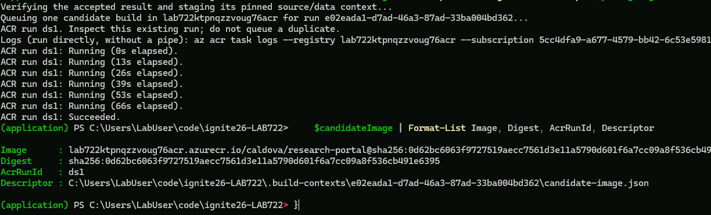
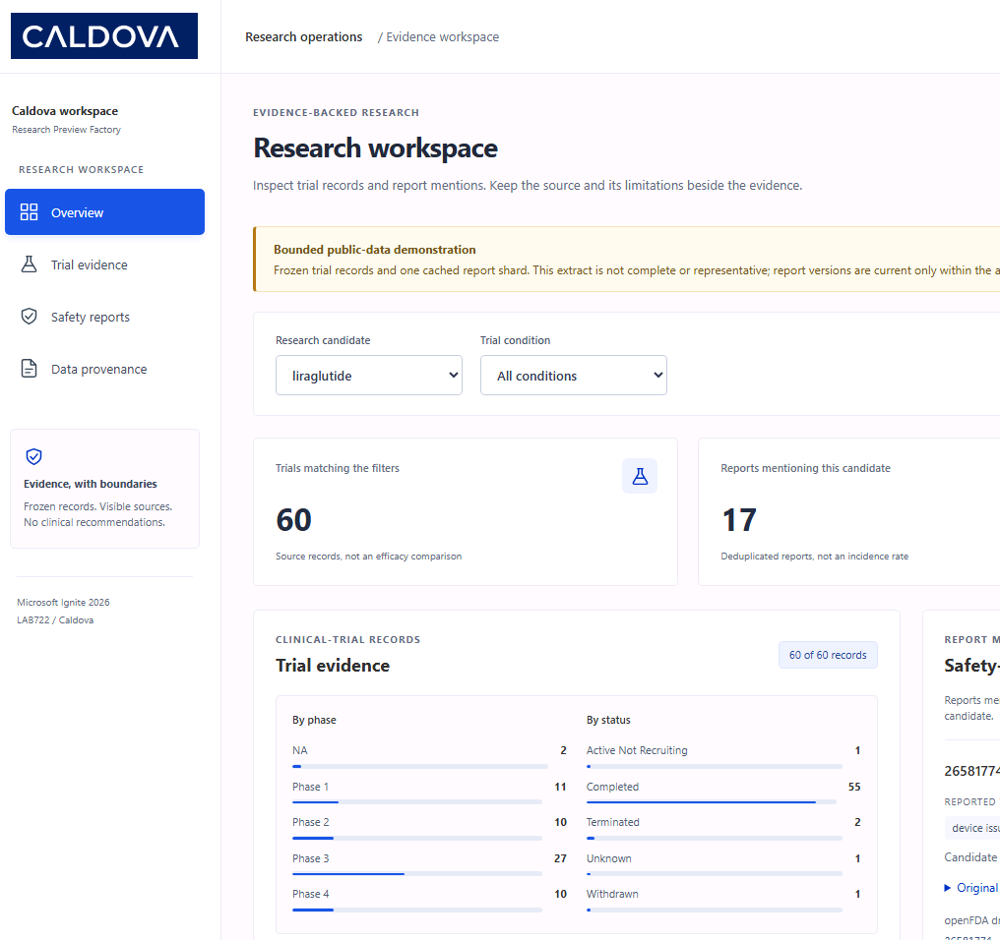

# 14. Build the application image

Next, we build the accepted agent changes in **your allocated Azure Container Registry (ACR)**. The helper verifies the run, source files, baseline, and data before queuing the build. The container build runs the acceptance tests before publishing an image.

## 14.1 Build from your accepted result

Build in your allocated registry using the accepted result:

```powershell
. {
    $ErrorActionPreference = 'Stop'
    if (-not $resultPath -or -not $result) { throw 'An accepted worker result is required before building.' }
    $packageArgs = @{
        ResultPath = $resultPath
        ResultSha256 = $resultSha256
        BaselineDescriptorPath = $baselineDescriptorPath
        FrozenArtifactDirectory = (Split-Path -Parent $env:LAB_DATA_MANIFEST)
        ManifestSha256 = $env:LAB_DATA_MANIFEST_SHA256
        ApprovedRunId = [guid] $runId
        Purpose = $env:LAB_STARTUP_PURPOSE
        RegistryName = $labOutputs.AZURE_CONTAINER_REGISTRY_NAME
        SubscriptionId = [guid] $labOutputs.AZURE_SUBSCRIPTION_ID
        ResourceGroupName = $resourceGroupName
        Tag = ('participant-' + $runId)
    }
    [void] (Read-Host 'Press Enter to build this accepted run in your allocated ACR')
    $buildDestination = Join-Path '.build-contexts' $runId
    $candidateImage = $null
    $candidateImage = .\scripts\build-agent-candidate.ps1 @packageArgs -Destination $buildDestination
    $candidateImage | Format-List Image, Digest, AcrRunId, Descriptor
}
```

**Expected:** a published image with a `sha256:` digest and an ACR build-run ID. The digest identifies the exact image bytes; a movable tag does not.



This is an example; your registry, ACR run ID and image digest will differ.

`ApprovedRunId` selects the validated source run. It is not approval to deploy. Keep the image descriptor and leave its approval flags unchanged.

If the build fails or log streaming stops, inspect the **existing ACR run** with your instructor before queuing another build. If you cannot complete it, skip **Deploy your image** and use the catch-up note at the end of **Try the completed application**.

The helper prints staging progress, the queued ACR run ID and periodic status/elapsed-time messages. It does not stream the build log into PowerShell. To inspect the existing log, run the exact scoped `az acr task logs` command it prints **directly**, without piping or capturing it: Windows CLI log output can fail on Unicode when redirected. A log-display failure is not proof of a failed build; inspect that same run before retrying.

### 14.1.1 Recover an existing build without rebuilding

If a build was submitted but the helper stopped before returning `$candidateImage`, keep the original accepted result and `.build-contexts\<run-id>` directory unchanged. With your instructor, inspect the existing runs:

```powershell
az acr task list-runs `
    --registry $labOutputs.AZURE_CONTAINER_REGISTRY_NAME `
    --subscription $labOutputs.AZURE_SUBSCRIPTION_ID `
    --top 5 --only-show-errors --output json `
    --query "[].{runId:runId,status:status,images:outputImages}"
```

Select the run for this candidate's repository/tag, then run the block below in the same PowerShell session. It stages a fresh verification context, checks it against the original context and validates that existing run's status and image identity. **It never queues another build.** A failed or foreign run is rejected, not treated as an accepted image.

```powershell
. {
    $ErrorActionPreference = 'Stop'
    if (-not $packageArgs -or -not $runId) { throw 'The original accepted build arguments are required.' }
    $existingAcrRunId = (Read-Host 'Existing ACR build-run ID confirmed above').Trim()
    $resumeDestination = Join-Path '.build-contexts' "$runId-resume-$([guid]::NewGuid().ToString('N'))"
    $candidateImage = $null
    $candidateImage = .\scripts\build-agent-candidate.ps1 @packageArgs `
        -Destination $resumeDestination -ResumeAcrRunId $existingAcrRunId `
        -OriginalBuildContext (Join-Path '.build-contexts' $runId)
    $candidateImage | Format-List Image, Digest, AcrRunId, Descriptor
}
```

<!-- pagebreak -->

# 15. Deploy your image

Your agent team’s accepted changes are now packaged in an image in your allocated Azure Container Registry. Next, update the existing **caldova-research** application from the incomplete starter to that image. You do not need to rerun the agents or rebuild it.

You are the human reviewer for this lab deployment. Check **this run, dataset, image digest and actual target application**, record your decision in your lab notes, and authorize the update at the prompt below. A successful build alone does not make that decision for you; no instructor sign-off is required.

## 15.1 Update the existing application

The block below first displays the accepted run, image digest and deployment target.

The helper configures read-only access to pull the image from your allocated registry and updates the application using its **exact digest**, rather than a movable tag. It then pauses for you to inspect the deployment result.

After you continue, the final commands verify the running image, its data manifest and the frozen dataset. Expect `application_ready`, `application_manifest_verified` and `frozen_data_verified` to all be `True`.

If deployment or verification fails, keep the error and stop. Once all three checks pass, continue to **Try the completed application** to inspect your team’s features in the browser.


```powershell
. {
    $ErrorActionPreference = 'Stop'
    if (-not $candidateImage -or -not $candidateImage.Digest) { throw 'A successfully built image is required before deployment.' }
    if (-not $labOutputs -or $labOutputs.CALDOVA_APPLICATION_NAME -cne 'caldova-research' -or
        [string]::IsNullOrWhiteSpace($labOutputs.CALDOVA_APPLICATION_REGION)) {
        throw 'Verify the starter application first so its actual Express environment and region are known.'
    }
    $imageTarget = @{
        SubscriptionId = [guid] $labOutputs.AZURE_SUBSCRIPTION_ID
        ResourceGroupName = $resourceGroupName
        RegistryName = $labOutputs.AZURE_CONTAINER_REGISTRY_NAME
        ExpressEnvironmentName = $labOutputs.EXPRESS_ENVIRONMENT_NAME
        AppName = 'caldova-research'
        PortalCreatedApplication = $true
    }
    $candidateImage | Format-List RunId, Digest | Out-Host
    $imageTarget | Format-List | Out-Host
    [void] (Read-Host 'Review this run, dataset, digest and target, then press Enter to authorize deployment')
    $readiness = $null
    $deployment = $null
    $deployment = .\scripts\deploy-research-preview.ps1 @imageTarget `
        -ImageDigest $candidateImage.Digest -PreviewState reference -AuthorizeDeployment
    $deployment | Format-List | Out-Host
    [void] (Read-Host 'Inspect the deployment result, then press Enter to verify the running image and data')
    $env:LAB_APPLICATION_NAME = $deployment.AppName
    $env:LAB_APPLICATION_IMAGE_SOURCE = 'LabRegistry'
    $env:LAB_APPLICATION_IMAGE_DIGEST = $candidateImage.Digest
    $env:LAB_APPLICATION_PREVIEW_STATE = 'reference'
    $env:LAB_APPLICATION_ENVIRONMENT_SOURCE = 'Portal'
    $readiness = $null
    $readiness = .\scripts\start-lab.ps1 -ResourceGroupName $resourceGroupName `
        -Region $region -Mode Readiness | ConvertFrom-Json
    if (-not $readiness.application_ready -or -not $readiness.application_manifest_verified -or
        -not $readiness.frozen_data_verified) { throw 'Deployed image/data verification failed. Stop here.' }
    $readiness | Select-Object application_ready, application_manifest_verified, frozen_data_verified
}
```

The command updates your existing scoped application in the Express environment retained by starter verification; it is not a read-only check. Its final stage verifies the exact running image and data without moving either environment.

**Expected:** all three values are `True`. Stop on a deployment or readiness error; do not switch images to hide it.

<!-- pagebreak -->

# 16. Try the completed application

1. In `https://containerapps.azure.com/`, select **caldova-research**. Check that the active image digest matches the one you deployed.
2. Open the application:

```powershell
. {
    $ErrorActionPreference = 'Stop'
    if (-not $readiness -or -not $readiness.application_ready -or
        -not $readiness.application_manifest_verified -or -not $readiness.frozen_data_verified -or
        -not $readiness.outputs -or
        [string]::IsNullOrWhiteSpace($readiness.outputs.CALDOVA_APPLICATION_URL)) {
        throw 'Verify your deployed application and its URL before opening it.'
    }
    $url = $readiness.outputs.CALDOVA_APPLICATION_URL
    Start-Process $url
}
```

3. Select a candidate and trial topic. The research panel should now show trial results and the available adverse-event reports.
4. Change the **trial** topic, phase, or status. These filters should affect the trials, not the candidate's safety-report selection.
5. Inspect a source citation and the limitations notice.



An openFDA **Source partition ZIP** link downloads a bulk source archive, not an individual report page. The report ID and **Original report fields** disclosure identify the selected frozen report without downloading or importing that archive.

The selected data has **no retained tirzepatide safety reports**. An empty result for that candidate is expected. Report counts do not establish causation, incidence, or comparative safety.

**Checkpoint:** the application's missing features now work, and the running image matches the approved build.

> [+Help] If you could not complete the agent run or image build
>
> Keep the failed output and skip the unfinished worker, build, and **Deploy your image** commands. Review the supplied reference digest and your allocated target, then run the commands below. They load a completed application so you can continue; they do not mark your unfinished work as passed.
>
> ```powershell
> . {
>     $ErrorActionPreference = 'Stop'
>     $referenceTarget = @{
>         SubscriptionId = [guid] $labOutputs.AZURE_SUBSCRIPTION_ID
>         ResourceGroupName = $resourceGroupName
>         RegistryName = $labOutputs.AZURE_CONTAINER_REGISTRY_NAME
>         ExpressEnvironmentName = $labOutputs.EXPRESS_ENVIRONMENT_NAME
>         AppName = 'caldova-research'
>         PortalCreatedApplication = $true
>     }
>     if ($images.application_name -cne $referenceTarget.AppName -or
>         $images.dataset.manifest_sha256 -cne $env:LAB_DATA_MANIFEST_SHA256) {
>         throw 'The reference image does not match this application and data.'
>     }
>     [void] (Read-Host 'Review the reference digest and target, then press Enter to authorize catch-up')
>     $readiness = $null
>     $referenceDeployment = .\scripts\deploy-research-preview.ps1 @referenceTarget `
>         -ImageSource ReferenceRegistry -ReferenceAnonymousPull `
>         -ImageDigest $images.images.reference.digest -PreviewState reference -AuthorizeDeployment
>     $env:LAB_APPLICATION_NAME = $referenceDeployment.AppName
>     $env:LAB_APPLICATION_IMAGE_SOURCE = 'ReferenceRegistry'
>     $env:LAB_APPLICATION_IMAGE_DIGEST = $images.images.reference.digest
>     $env:LAB_APPLICATION_PREVIEW_STATE = 'reference'
>     $env:LAB_APPLICATION_ENVIRONMENT_SOURCE = 'Portal'
>     $readiness = $null
>     $readiness = .\scripts\start-lab.ps1 -ResourceGroupName $resourceGroupName `
>         -Region $region -Mode Readiness | ConvertFrom-Json
>     if (-not $readiness.application_ready -or -not $readiness.application_manifest_verified -or
>         -not $readiness.frozen_data_verified) { throw 'The reference deployment did not pass verification.' }
>     $readiness | Select-Object application_ready, application_manifest_verified, frozen_data_verified
> }
> ```
>
> All three values must be `True`. If the original starter/data checks or this deployment failed, stop and ask for help.
>
> Repeat steps 1-5 above, comparing the active image with `$images.images.reference.digest`. Record **ready-made reference**, then continue to **Compare with a recorded example**. No shared-registry credentials are needed.
