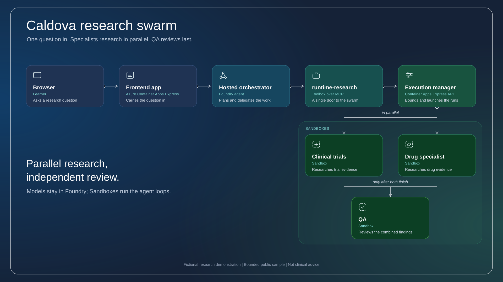
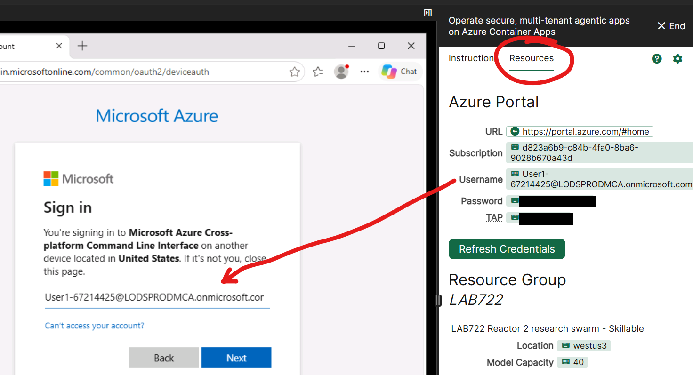
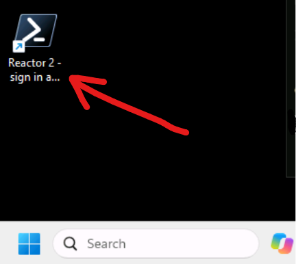
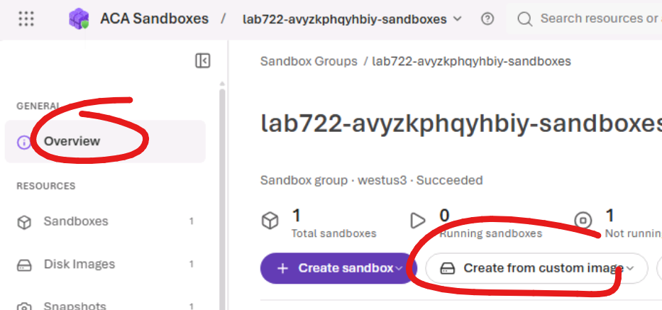
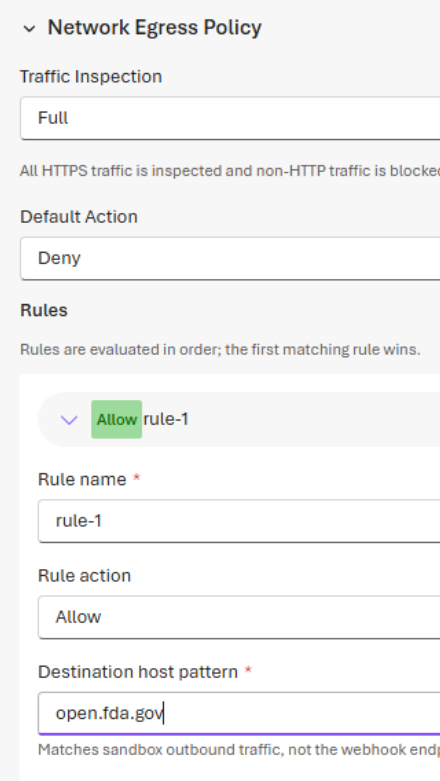
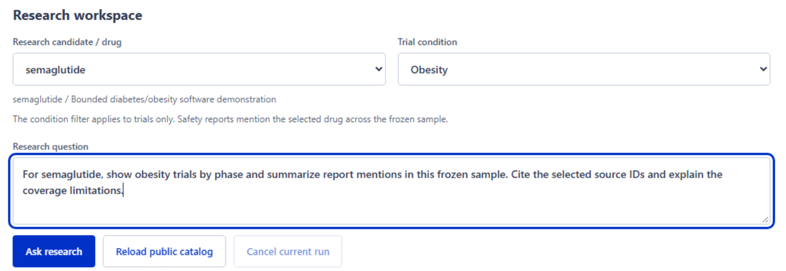
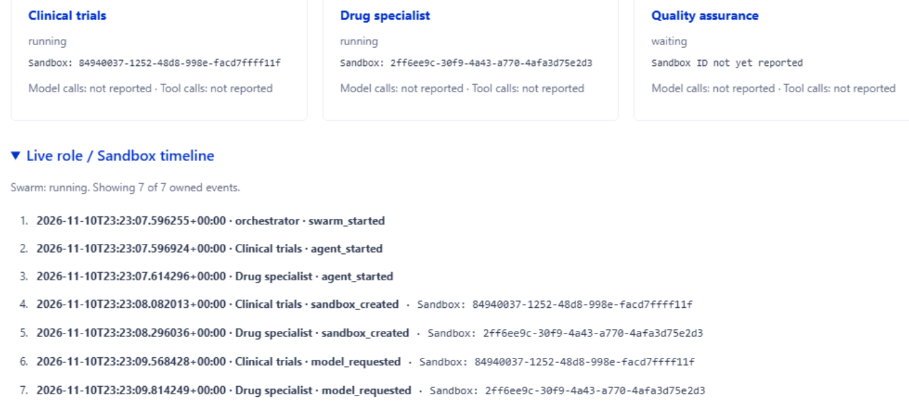

# LAB722: Operate secure, multi-tenant agentic apps on Azure Container Apps

## LAB722: Operate a Sandbox-resident research swarm

In this lab you will ask the Caldova application a question about a drug in a frozen public dataset. Watch a Foundry-hosted orchestrator delegate to clinical-trials, drug-specialist and quality-assurance agents running in on-demand ACA Sandboxes. Use the portals to inspect the application tier, agent compute, ownership and cleanup. We will focus on architecture and operations, not an application-building.



| Objective | By the end you can |
| --- | --- |
| 01 | Use the research application, inspect outcomes and explain its checks and limitations. |
| 02 | Observe full specialist agents appear on demand, explain concurrency and independently verify task compute disappears. |
| 03 | Inspect a preloaded agent and locate Express, Foundry and Toolbox in the automated request path. |
| 04 | Correlate a run with its owner and demonstrate allowed Alice/Bob work and denied cross-customer access. |

Use the same sequence in a guided session or at your own pace. No measured learner completion time or human comprehension result is implied.

===

# 1. Sign in to your allocated environment

The Windows password, Azure credentials, and Caldova demo passwords serve different purposes. Retrieve your credentials from the **Resources Tab** of of the lab VM browser window.



| Credential | Use |
| --- | --- |
| Windows VM username/password | Sign in to the supplied Windows desktop. |
| Allocated Azure credentials | Authenticate the Azure session and portals with the lab's dynamic credentials (username, password, TAP) |
| Alice/Bob demo passwords | Sign in to Caldova app after preparation. These are not Azure credentials. |

## 1.1 Run the Data Plane Deployment



1. Sign in to Windows. In the lab client's **Resources** panel, locate the allocated Windowns password.
2. Open (by double clicking) **Reactor 2 - sign in and prepare** on the desktop.
3. Follow the displayed device-login instructions in the browser.
4. Confirm the selected subscription matches Resources. Allow preparation to finish. Do not launch another preparation while one is running. In this step we're finalizing the control plane updates, as step that may take up to **5 min to complete**.
5. Continue only after the terminal shows **REACTOR2_SKILLABLE_READY**, followed by the frontend URL.


**Recovery for a Password-only or wrong CLI Session:** close or leave the failed preparation at its idle prompt. In PowerShell 7 run `az logout`, reopen the delivered shortcut and authenticate with the allocated **TAP**. On the tested allocation, password-only sign-in succeeded but a subsequent Foundry connection write was rejected because MFA had not been satisfied; normal logout and TAP-backed sign-in resolved it.

If preparation fails for another reason, retain the exact error and contact the facilitator.

## 1.2 Inspect our Deployment

In the same PowerShell terminal run the following and copy and paste the output to Notepad for later reference:

```powershell
$v = Get-Content 'C:\Lab\Reactor2\learner-values.json' -Raw |
    ConvertFrom-Json

$v | Format-List -Property ($v.PSObject.Properties.Name | Sort-Object)
```

**Expected:** the selected subscription equals `$SubscriptionId`, the resource group is **LAB722**, and the region is **westus3**.

The initial preparation shortcut is system-installed on the shared desktop. The final **Reactor 2 research app** shortcut creates a shortcut to the Caldova frontend application on the desktop. Open that final shortcut, or copy `$FrontendUrl` from your own values.

===

# 2. Locate the application and its tool boundary

**Goal:** identify where the request runs before sending one.

**Predict:** should the three specialist roles already occupy three running task Sandboxes?

## 2.1 Explore Express first

1. Open **[Azure Container Apps portal](https://containerapps.azure.com)**. Sign in with the allocated Azure user using TAP-backed authentication.
2. Select your allocated subscription and **LAB722**.
3. Find the `$FrontendName` and `$ExecutionName` applications. Open each app's **Live Overview**.
4. Confirm both apps are **Running / Ready for traffic** and **Environment mode** is **Express**. Feel free to look at their log stream or launch into their console. The code can be inspected under [Frontend service](https://github.com/microsoft/ignite26-LAB722/blob/main/src/reactor/frontend.py) and [Execution manager's API](https://github.com/microsoft/ignite26-LAB722/blob/main/src/reactor/execution.py).
5. The following environment variables are used for the frontend and execution manager:

**Frontend environment variables**

| Variable | Expected value | Why it is needed |
|---|---|---|
| `AZURE_CLIENT_ID` | Frontend managed identity's **client ID** | Selects the identity used to authenticate requests to the execution API and Foundry. |
| `EXECUTION_API_AUDIENCE` | `api://<execution-api-application-client-id>` | Requests an access token intended specifically for the execution API. Must match the backend's audience. |
| `EXECUTION_ENDPOINT` | Execution API's HTTPS base URL | Tells the frontend where to send login, run, evidence and cancellation requests. |
| `FRONTEND_PUBLIC_ORIGIN` | `https://<frontend-hostname>` | Supplies the browser-facing origin for CSRF checks behind Azure's HTTPS ingress. Do not include a path or trailing slash. |
| `HOSTED_RESPONSES_ENDPOINT` | Exact Foundry hosted agent Responses endpoint, including its API-version query | Routes research requests to the hosted orchestrator. May be empty during preparation, but research submissions remain disabled until configured. |
| `REACTOR_COMPONENT` | `frontend` | Starts the frontend application from the shared services image. |

**Backend environment variables**

| Variable | Expected value | Why it is needed |
|---|---|---|
| `AZURE_CLIENT_ID` | Execution managed identity's **client ID** | Selects the backend identity used for Sandbox operations and model inference. This differs from the frontend identity. |
| `AZURE_SUBSCRIPTION_ID` | Subscription containing the Sandbox group | Scopes Sandbox lifecycle operations to the correct subscription. |
| `AZURE_TENANT_ID` | Microsoft Entra tenant ID | Identifies the tenant trusted when validating incoming service access tokens. |
| `EXECUTION_API_AUDIENCE` | `api://<execution-api-application-client-id>` | Validates that incoming tokens were issued for this dedicated execution API. Must match the frontend configuration. |
| `FRONTEND_OBJECT_ID` | Frontend managed identity's **principal/object ID** | Authorizes the frontend as a trusted service caller. This is not its client ID. |
| `MODEL_DEPLOYMENT` | Foundry model deployment name, such as `gpt-5.2` | Selects the model used by the Sandbox agents through the backend's model relay. Required when the research swarm is enabled. |
| `PROJECT_OBJECT_ID` | Foundry project's managed identity **principal/object ID** | Authorizes project-managed-identity calls arriving through the Toolbox connection. |
| `REACTOR_AGENT_SWARM_ENABLED` | `true` | Enables the specialist/QA research swarm and model relay. Without it, research operations are unavailable. |
| `REACTOR_ALICE_PASSWORD` | Secret containing Alice's demo password | Seeds Alice's application account. Must contain 12-1024 characters and differ from Bob's password. |
| `REACTOR_BOB_PASSWORD` | Secret containing Bob's demo password | Seeds Bob's application account. Must contain 12-1024 characters and differ from Alice's password. |
| `REACTOR_COMPONENT` | `execution` | Starts the execution-manager application from the shared services image. |
| `REACTOR_MODEL_ENDPOINT` | `https://<foundry-account>.openai.azure.com/openai/v1/chat/completions` | Provides the model inference endpoint used by the backend's relay. Required when the research swarm is enabled. |
| `RESOURCE_GROUP` | Resource group containing the Sandbox group | Scopes Sandbox lifecycle operations to the intended resource group. |
| `SANDBOX_GROUP` | Sandbox group name | Identifies the group in which specialist and QA task Sandboxes run. |
| `SANDBOX_REGION` | Sandbox group region, such as `westus3` | Selects the regional endpoint for Sandbox operations. |
| `SANDBOX_SNAPSHOT_ID` | Prepared agent-capable snapshot ID | Supplies the preloaded agent environment and frozen dataset from which task Sandboxes are created. |
6. On **Identity**, inspect only the attached managed identities. Compare their object/principal IDs with `$FrontendObjectId` and `$ExecutionObjectId` in your values.


## 2.2 Locate Foundry and Toolbox

Foundry Toolbox provides a secure and governend toolchain layer away from unpredictable agent code. In this next stage we're exploring this part of the application.

In Azure portal, **[open your Foundry account](https://ai.azure.com)**, then project **reactor**. Locate the hosted agent named **reactor-research-orchestrator** and the **runtime-research** Toolbox. A registered agent version must actually be active.

Under the project's connected resources, find **reactor-swarm-execution**. Its authentication is **Project Managed Identity**. Compare its target and audience with `$ExecutionUrl`.

`runtime-research` is the Toolbox; `reactor-swarm-execution` is a connection, not an executable tool. There are three related objects:

| Object | What it does |
| --- | --- |
| runtime-research | Foundry-managed Toolbox exposing the execution API's operations through an MCP endpoint |
| reactor-execution | The OpenAPI tool registered inside that Toolbox; defines the available operations and their request/response schemas |
| reactor-swarm-execution | Foundry project connection specifying the execution-manager URL, authentication audience and Project Managed Identity authentication |

The managed Toolbox advertises `reactor___clinical_trials`, `reactor___drug_specialist` and `reactor___quality_assurance`. Each requires a request body and **X-Reactor-Run-Grant**. The backend supplies that grant.

During a full end-to-end execution the frontend identity calls the user-facing execution API; the Foundry project identity calls specialist operations. The execution manager's identity accesses the allocated Sandbox group and model. Tokens for those Azure calls do not enter the task Sandbox.

**Explain:** which component creates the Sandbox when the orchestrator selects a specialist tool, and where does the specialist's agent loop run?

===

# 3. Create and Inspect an Agent manually

**Goal:** Create and explore the compute that the application will later create automatically. This sandbox is only explorative and won't be used for the application.

## 3.1 Record the baseline

1. Open **[ACA Sandboxes portal](https://sandboxes.azure.com)** in the same allocated-user, TAP-backed browser session.
2. Select your subscription, **LAB722**, and `$SandboxGroupName`.
3. On **Overview**, record the teaching Sandbox, custom image and snapshot. Compare their IDs with `SeedId`, `$AgentDiskId` and `$SnapshotId`.
4. Open **Sandboxes** and use **Refresh sandboxes**. There should already be an initial sandbox created as a test/template.

Before any research, expect one sandbox , one disk image and one snapshot.

## 3.2 Create your Sandbox



1. Return to **Overview** and choose **Create from custom image**.
2. Select the entry containing your `$AgentDiskId`. The tested portal displayed **LAB722**, the disk UUID and a date, rather than a friendly image name.
3. Choose **L: 2 cores / 4 GiB / 40 GiB**. Set the name label to **reactor-manual-inspection**.
4. Expand **Advanced**, then **Network Egress Policy**. Select **Full** traffic inspection first, then default action **Deny**. Set up an **Allow** rule for the exact host `open.fda.gov`.



5. Leave ports, volumes and connectors unconfigured. Review those settings and submit **Create** once.
6. Wait for **Running**.

## 3.3 Inspect the Sandbox workload and data

Open the Sandbox terminal and run these Linux commands there, not in Windows PowerShell:

```bash
head -45 /opt/lab722-agent/src/reactor/agent_runtime.py
ls -l /opt/lab722-data
sha256sum /opt/lab722-data/* /opt/lab722-agent/src/reactor/agent_runtime.py
```

Locate the three `ROLE_INSTRUCTIONS`, protocol **research-agent-v4**, the **12-turn** bound and **180-second** specialist wall-time bound. The code and data are preloaded; a Sandbox does not download the dataset or a model during the request.

The three data files should show read-only permissions, `-r--r--r--`. The role loop coordinates tools and remote model requests. Generated Python runs separately with a cleared environment, UID 65534, no-new-privileges and resource limits.

## 3.4 Exercise the Egress rules

**Predict:** which request should work: `open.fda.gov` or `example.com`? Why?

Return to the Sandboxe's **browser terminal** and paste this block. It uses the installed Python runtime to send two read-only requests and print their HTTP status:

```bash
python3 - <<'PY'
from urllib.request import urlopen
from urllib.error import HTTPError

for url in ("https://www.bing.com/", "https://open.fda.gov/apis/", "https://example.com/"):
    try:
        with urlopen(url, timeout=15) as response:
            print(f"{url}: HTTP {response.status}")
    except HTTPError as error:
        print(f"{url}: HTTP {error.code}")
PY
```

**Compare:** expect **HTTP 200** for `open.fda.gov` and **HTTP 403** for `example.com` and `bing.com`.

===

# 4. Ask a real Research question

**Goal:** exercise the full app by connecting the research experience to actual ephemeral agent compute.

## 4.1 Sign in to the frontend Caldova app

Open the **Reactor 2 research app** desktop shortcut.

The demo credentials are encrypted for the Windows learner account in `C:\Lab\Reactor2\.build-contexts\demo-credentials.clixml`. To retrieve Alice's password privately in your own PowerShell window:

```powershell
$demo = Import-Clixml -LiteralPath '.\.build-contexts\demo-credentials.clixml'
$demo.alice.GetNetworkCredential().Password
```

Use username **alice** in the normal Caldova sign-in form. On occasion the login may have to be repeated more than once.

**Expected:** **user-alice / customer-alice (application-asserted)**.

## 4.2 Submit and observe

Keep the Sandbox portal open beside Caldova.

1. In Caldova select **semaglutide** and trial condition **Obesity**.
2. Ask: **For semaglutide, show obesity trials by phase and summarize report mentions in this frozen sample. Cite the selected source IDs and explain the coverage limitations.**
3. Click **Ask research** once.
4. Expand **Inspect execution** and record the run ID, conversation ID and idempotency key. These are correlation values, not permission to access another customer's result.



5. Immediately use **Refresh sandboxes** in the Sandbox portal. Inspect the new task rows and their **+ more** label descriptions. Refresh again as the work progresses.
6. Compare **run**, **user**, **customer**, **conversation**, **step**, and **purpose: reactor-task** with the application's timeline.

**Predict:** three roles do not mean three simultaneous task Sandboxes. Clinical and drug specialists run concurrently, with at most two task Sandboxes active. QA is staged after their results.



The application timeline should show actual `sandbox_created`, `model_requested`, `tool_selected`, `model_completed`, validation and deletion events.

## 4.3 Inspect accepted evidence

Continue only when the owned run is completed and its evidence is **accepted**, all three independent assessments pass, and QA has no outstanding issues.

For this exact selection, expect:

| Evidence | Expected |
| --- | --- |
| Trial records | **30** |
| Phase counts | PHASE1 **8**, PHASE2 **4**, PHASE3 **15**, PHASE4 **3** |
| Safety-report records mentioning semaglutide | **21** |
| QA | Passed, no issues; exact selected trial/report IDs |
| Provenance | `caldova-public-lab-use-v2`; the same three frozen-file hashes |

Inspect the phase/status charts, reaction-term chart, source IDs and original-source links. In **Inspect execution**, enter the evidence artifact ID listed by the owned run and select **Inspect evidence artifact**. Compare agent ownership, source hashes, model/tool counts and execution receipts with the timeline.

Use **Refresh sandboxes** after completion. The task IDs from the timeline must be absent; the teaching seed/image/snapshot remain. A JSON `cleaned: true` field is not an independent deletion check.

**Explain:** which observations show compute was created on demand and disappeared afterward, rather than simply being hidden by the application?

===

# 5. Test and exercise tool and data ownership

## 5.1 Allowed work and denied cross-customer access

1. Keep Alice signed in. Record her accepted run ID.
2. Open a separate **private browser window**, not merely a second tab sharing Alice's cookies.
3. Retrieve `$demo.bob.GetNetworkCredential().Password` privately and sign in as **bob**. Confirm **user-bob / customer-bob**.
4. In Bob's **Inspect execution**, enter Alice's run ID and choose **Inspect owned run**. Expect **403 Forbidden**, shown as **Access denied**, not Alice's result. **The UI clears the current account and owned results after a denial.** Sign in again before the next check.
5. Start Bob's own research with semaglutide/Obesity. Confirm an accepted result and Bob-owned labels in the Sandbox portal.
6. Return to Alice and try Bob's run/evidence IDs. Expect denial while Bob's own allowed result remains accessible.

**Explain:** which identity is application-asserted, which identities authenticate service calls, and which observed labels carry customer context into task compute?

===

# 6. What you learned

In this lab, you operated a multi-agent research application across Azure Container Apps Express, Microsoft Foundry and ACA Sandboxes. You followed a Caldova research question from the frontend through a Foundry-hosted orchestrator and its MCP Toolbox to specialist agents. You observed clinical-trials and drug specialists working in parallel, followed by a separate QA agent that checked their results against a frozen public dataset.

You inspected managed identities and service authentication, configured Sandbox network egress rules, and saw and tested production example of customer isolation through Foundry Toolbox. You confirmed that Alice and Bob could access their own results but not each other's. You traced ownership from an application request into its Sandbox labels and distinguished the agent code running in a Sandbox from model inference running in Foundry.

If you wish to deploy or experiment further with this lab you can find it at [**https://github.com/microsoft/ignite26-LAB722**](https://github.com/microsoft/ignite26-LAB722).